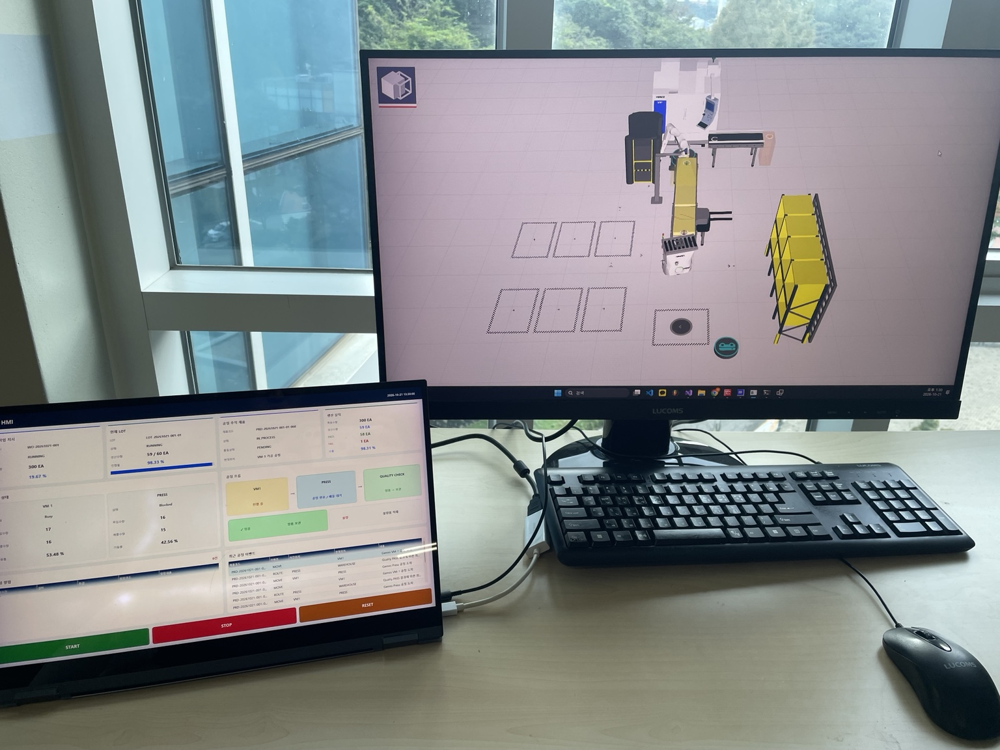

# PLC 설비 제어 · 생산정보 수집 프로그램

**C# HMI에서 제어 명령을 보내고, 가상 설비의 데이터를 받아 생산 현황과 이력을 조회하는 프로그램입니다.**

C# · WinForms · ASP.NET Core · MSSQL · MQTT · SignalR · MX Component

## 설비·HMI 연동 시연

**[▶ 시연 영상 보기 · 약 26초](docs/media/hmi-gemini-demo.mp4)** · [MP4 원본 열기](https://raw.githubusercontent.com/EddieEom/MES-System/main/docs/media/hmi-gemini-demo.mp4)

노트북의 WinForms HMI와 외부 모니터의 MELSOFT Gemini를 함께 촬영했습니다. 가상 설비의 움직임과 HMI 상태 변화를 볼 수 있습니다. 촬영 대상은 시뮬레이터 환경입니다.

## 어떤 프로그램인가요?

화면의 버튼이 설비 동작으로 이어지고, 설비에서 나온 정보가 다시 화면에 표시되는 과정을 직접 연결해 보고 싶었습니다. WinForms 화면과 서버·DB를 구성한 뒤 PLC 시뮬레이터와 가상 설비를 연결했습니다.

| 구현 기능 | 처리 내용 |
| --- | --- |
| 설비 제어 | HMI의 시작·정지·초기화 요청을 PLC 시뮬레이터로 전달 |
| 데이터 수집 | MQTT로 설비 상태·제품 이동·검사 결과 수신 |
| 생산 이력 | 제품 이동과 검사 결과 저장, 품질·LOT 관련 변경의 트랜잭션 처리 |
| 화면 조회 | 작업지시·생산 수량·설비 상태·알람 표시 |

## 개발 과정과 사용한 자료

개인 프로젝트를 위해 **㈜퍼씨엠에 필요한 공정과 연동 조건을 전달하고, MELSOFT Gemini 가상 생산설비 모델을 제공받았습니다.** 이 모델을 사용해 PLC 시뮬레이터와 연동했습니다.

저는 시작·정지·초기화, 생산 현황, 제품 이동·검사 이력, 알람 등 작업자 화면에 필요한 기능과 처리 순서를 정리했습니다. HMI·서버·Gateway·DB의 구성과 세부 설계는 AI와 함께 검토했고, C#·SQL·Python 코드 작성과 수정에도 AI를 활용했습니다.

생성된 코드를 프로젝트에 적용·연결하고, 버튼 입력에 따른 설비 동작과 화면 표시, API 응답, 로그와 DB 저장 결과를 확인했습니다. 문제가 생기면 재현 조건과 관련 코드·로그를 정리해 AI와 원인 후보를 검토하고 수정안을 적용했습니다.

| 구분 | 범위 |
| --- | --- |
| 제공받은 자료 | ㈜퍼씨엠의 MELSOFT Gemini 가상 생산설비 모델 |
| 직접 진행한 작업 | 필요한 기능·처리 순서 정리, 프로그램 연동, 오류 재현, 화면·로그·DB 결과 확인 |
| AI 활용 | 시스템 구성·세부 설계 검토, 코드 생성·수정, 측정 방법과 원인 후보 검토 |

발행 프로세스 재사용과 종료 처리를 보완한 과정은 아래 트러블슈팅에 정리했습니다. 프로세스 종료와 표준입력 정리를 확인한 것으로, 메모리 누수 개선 성과를 측정한 것은 아닙니다.

- [직접 진행한 작업·모델 제공 범위·AI 활용](docs/project-ownership-and-communication.md)
- [기능별 코드 호출 경로](docs/code-trace-guide.md)

## MQTT 장애 복구와 부하 검증

- **연결 관리:** 고정 Client ID, 지속 세션, QoS 1 구독, 연결 실패 시 1초 간격 재시도와 종료 시 취소·정리.
- **재현 도구:** 실제 Gateway MQTT 수신 코드를 링크한 시험에서 수신측 TCP 연결을 차단하고 복구 후 메시지 ID 누락·중복을 확인합니다.
- **화면 갱신:** HMI는 수신 이벤트마다 다시 그리지 않고 서버 API를 비동기로 조회한 뒤 1초 대기합니다. 갱신 실패가 반복 조회를 끝내지 않도록 보완했습니다.

**실행 결과:** 수신 구간 60,000건/약 60초, 단절 중 발행한 100건까지 고유 ID 60,100개 수신. 이번 시험의 누락·중복은 0건이었습니다. 운영 Router·DB·HMI는 제외한 결과입니다.

[시험 조건·실행 방법·결과 및 한계](docs/validation/mqtt-reliability.md)

QoS 1은 MQTT 구간의 전달 방식입니다. 운영 Router·DB의 멱등 처리, 발행측 오프라인 저장, 실제 Windows HMI 부하 시험은 별도 검증 대상이며 종단 간 무유실·초당 수천 건 PLC 처리·UI 무정지를 주장하지 않습니다.

## 통신 구조

| 구간 | 흐름 |
| --- | --- |
| 제어 명령 | HMI → 서버 API → SignalR → Gateway → MX Component → PLC 시뮬레이터 → 가상 설비 |
| 생산 데이터 | 가상 설비 → MQTT Broker → Gateway → 서버 API → DB |
| 화면 조회 | HMI → 서버 API → DB 결과 표시 |

MQTT로 생산 데이터를 수신하고, SignalR와 PLC 통신으로 제어 명령을 전달했습니다. 두 방향의 흐름을 구성하면서 수신·처리·저장의 역할을 나누는 방법을 공부했습니다.

[전체 구성도](docs/images/system-architecture.svg)

## 개발하면서 해결한 문제

### 가상 설비 정지와 MQTT 발행 지연을 나누어 확인했습니다

Gemini가 공정 중 멈췄습니다. STOP을 눌렀을 때 원자재 공급은 멈추는 반면 Gemini가 정지하는 현상은 별도 문제로 보인다고 전달하고, 통신 지연 오류와 MQTT 전송 시점의 로그를 제공했습니다.

설정 변경 후에도 문제가 반복돼 MQTT 발행 Python 코드를 제공했습니다. AI가 `subprocess.run()`으로 외부 발행 프로그램의 종료를 기다리는 구간을 병목 후보로 제시했고, 측정 코드를 적용해 로그를 확인했습니다. 이후 AI가 제안한 `mosquitto_pub.exe` 유지·재사용 방식을 적용하고, 변경 후 전송 요청 로그를 다시 전달했습니다.

본인 수행 내용과 AI 활용 범위

| 과정 | 직접 진행한 내용 | AI의 도움을 받은 내용 |
| --- | --- | --- |
| 증상 확인 | STOP에 따른 공급 중단과 Gemini 정지 현상을 구분해 전달 | 로그 해석과 분리 시험 방법 제안 |
| 지연 확인 | 설정 변경 후 재실행, Python 코드와 측정 로그 제공 | 블로킹 호출을 병목 후보로 분석, 측정 코드 제안 |
| 수정·재확인 | 재사용 방식 적용 후 실행 결과 전달, PRESS에도 같은 방식 적용 요청 | 발행 프로세스 재사용 코드 작성 |
| 종료 처리 | 유지되는 프로세스가 남지 않도록 보완 요청, 이후 발생한 `ResourceWarning` 전달 | 프로세스·표준입력 정리 방법과 수정 코드 제안 |

[코드와 측정 과정을 정리한 트러블슈팅](MES_Gemini_MQTT_통신최적화_트러블슈팅_2026-10-06.md)

변경 전후 측정의 종료 조건이 달라 개선 배수를 제시하지 않았습니다. 기록된 시간은 Python 호출 구간이며 Gateway 도착 시간과는 구분합니다.

### 검사 결과만 저장해서는 처리가 끝나지 않았습니다

검사 결과를 저장할 때 제품 품질 상태와 LOT 완료 판단도 함께 처리해야 했습니다. 관련 정보가 일부만 반영되지 않도록 저장 프로시저에서 하나의 트랜잭션으로 묶었습니다.

## 코드에서 확인할 부분

| 내용 | 코드 |
| --- | --- |
| MQTT 구독과 수신 | [MqttClientService](src/Mes.Gateway/Mqtt/MqttClientService.cs) |
| 메시지 종류에 따른 처리 분기 | [MqttMessageRouter](src/Mes.Gateway/Routing/MqttMessageRouter.cs) |
| 서버 제어 명령 수신 | [GatewaySignalRService](src/Mes.Gateway/Services/GatewaySignalRService.cs) |
| PLC 디바이스 제어 | [PlcControlService](src/Mes.Gateway/Services/PlcControlService.cs) |
| 테이블·저장 프로시저 | [database](database) |

제어 API의 `sent`는 서버가 명령을 보냈다는 뜻이므로, 실제 설비 동작과 PLC 상태를 함께 확인했습니다.

## 동작 확인

GX Simulator2와 MELSOFT Gemini에서 시작·정지·초기화, 동일 제품의 이동·검사 이력 저장, FAIL 경로, 알람 발생·표시·해제를 확인했습니다. 통신 장애 복구도 확인했습니다.

확인 환경은 GX Simulator2와 MELSOFT Gemini입니다. **실물 생산설비 연동과 장시간 연속 운전은 검증하지 않았습니다.** MQTT 단절 복구·부하 시험의 조건과 제외 범위는 위 시험 문서에 별도로 정리했습니다.

가상 설비·알람 화면

## 실행 방법

Windows, .NET 8, Visual Studio, SQL Server, Mosquitto, GX Works2·GX Simulator2, MX Component, MELSOFT Gemini가 필요합니다. 가상 설비 모델·PLC 프로그램과 COM 연결 환경은 별도로 준비해야 합니다.

1. `database/`의 테이블·저장 프로시저와 서버의 `ConnectionStrings:MesDatabase`를 준비합니다.
2. Mosquitto, PLC 시뮬레이터, MX Component 연결을 준비합니다.
3. `MES_SYSTEM.sln`에서 서버 → Gateway → Gemini → HMI 순서로 실행합니다.
4. Gateway 로그·PLC 디바이스·DB 저장 결과를 확인합니다.

Gateway 서버 기본 주소는 `https://localhost:7075`이며 `MES_SERVER_BASE_URL`로 변경합니다. MQTT 기본값은 `127.0.0.1:1883`, 구독은 `dt/#`, MX Component 논리국 번호는 1입니다. HMI 주소와 COM 참조는 실행 환경에 맞춥니다.
