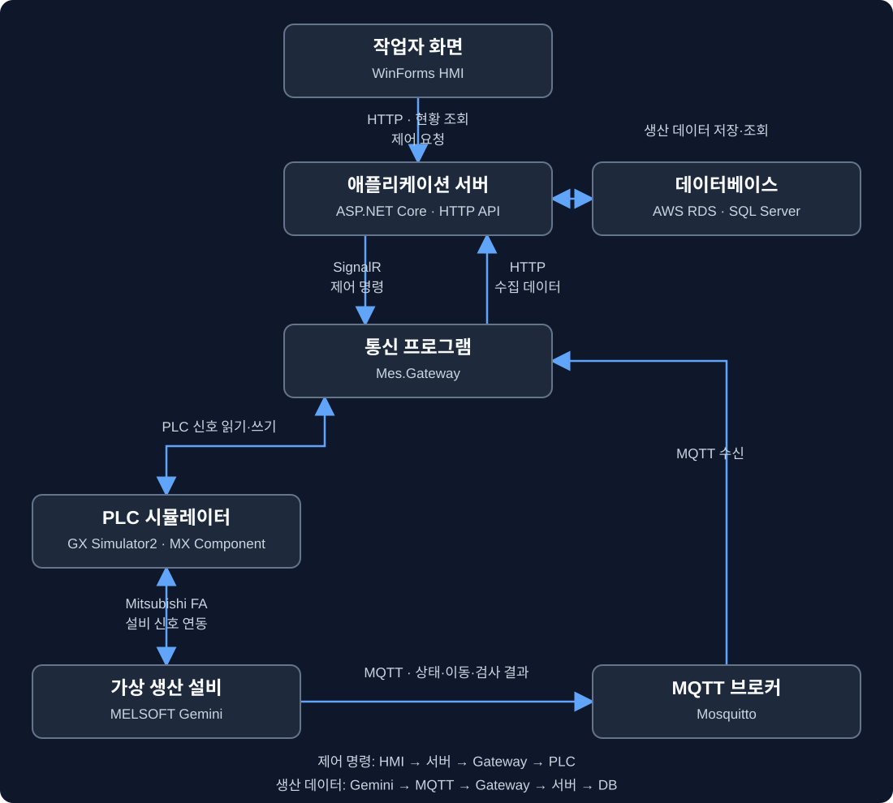

# 디지털 트윈 기반 PLC 설비 제어 프로그램

**가상 설비의 제어부터 생산 데이터 수집·HMI 모니터링까지**

작업지시·LOT·제품 이동·검사 이력 관리 등 MES 관련 기능을 함께 구현한 개인 프로젝트입니다. GX Simulator2와 MELSOFT Gemini 환경에서 동작을 확인했습니다.

    

| 개발 형태 | 담당 범위 | 확인 환경 |
| :--- | :--- | :--- |
| **개인 프로젝트** | **통신 · 서버 · DB · HMI** | GX Simulator2 · MELSOFT Gemini |

## 실행 화면

**WinForms HMI** · 작업지시, 생산 실적, 공정 흐름과 제어 버튼을 한 화면에 구성했습니다.

<table><tr><th width="50%">가상 생산 설비</th><th width="50%">알람 표시</th></tr><tr><td></td><td></td></tr></table>

<b>제품 이력 조회 보기</b>

**제품 추적** · 동일 제품 코드의 이동 기록과 PASS 검사 결과를 DB에서 조회한 화면입니다.

## 🏭 구현 요약

<table>
<tr><td width="33%" valign="top"><b>설비 제어</b>  HMI 제어 명령 START · STOP · RESET MX Component로 PLC 신호 전달</td>
<td width="33%" valign="top"><b>생산 데이터 수집</b>  MQTT 메시지 수신 제품 이동 · PASS / FAIL 서버와 DB에 이력 저장</td>
<td width="33%" valign="top"><b>HMI 모니터링</b>  작업지시 · LOT 진행률 생산수량 · 수율 · 설비 상태 알람 발생·해제 표시</td></tr>
</table>

## 🔗 시스템 구성

| 구성 요소 | 사용 기술 |
| :--- | :--- |
| 작업자 화면 | WinForms HMI |
| 애플리케이션 서버 | ASP.NET Core Web API |
| 통신 프로그램 | Mes.Gateway · SignalR · MQTTnet |
| PLC 연동 | GX Simulator2 · MX Component |
| 가상 생산 설비 | MELSOFT Gemini |
| 메시지 전달 | MQTT · Mosquitto |
| 데이터 저장 | AWS RDS for SQL Server |

### 생산 데이터

Gemini에서 설비 상태, 제품 이동, 검사 결과가 발생하면 MQTT로 전송합니다. Gateway가 메시지를 받아 서버에 전달하고, 서버가 DB에 저장합니다. HMI는 서버에서 최신 정보를 조회해 화면에 표시합니다.

### 제어 명령

HMI에서 버튼을 누르면 서버에 제어 요청을 보냅니다. 서버는 SignalR로 Gateway에 명령을 전달하고, Gateway는 MX Component를 통해 PLC 신호를 변경합니다. Gemini는 연결된 PLC 신호를 사용해 공정을 제어합니다.

HMI의 현황 조회에는 HTTP를 사용하고, 서버에서 Gateway로 제어 명령을 보낼 때는 SignalR를 사용합니다.

## ✅ 동작 확인

아래 항목은 개발 환경에서 직접 동작을 확인했습니다.

| 항목 | 확인 내용 |
|---|---|
| HMI 현황 표시 | 작업지시, LOT, 생산 실적, 설비 상태, 최근 이벤트 표시 |
| PLC 제어 | HMI에서 START·STOP·RESET 명령 전달 |
| 불량 처리와 이력 | 같은 제품 코드로 이동 → FAIL 판정 → 불량 적재 → DB 이력 조회 |
| 알람 발생과 해제 | 알람 발생 → HMI 활성 알람 표시 → 알람 해제 확인 |

불량 경로의 화면 표시뿐 아니라, 같은 제품의 검사 결과와 이동 기록이 DB에 남는 것까지 확인했습니다. 알람도 발생부터 화면 표시, 해제까지 연결해서 확인했습니다.

## 🔧 문제 해결

### MQTT 전송 지연

처음에는 메시지를 보낼 때마다 `mosquitto_pub.exe`를 새로 실행했습니다. 이 과정에서 Gemini 처리가 지연되었고, PLC 통신 지연 오류가 함께 발생했습니다.

이후 메시지 전송 프로그램을 계속 실행해 둔 상태에서 데이터를 전달하는 방식으로 변경했습니다.

자세한 내용은 아래 기록에 정리했습니다.

[Gemini MQTT 통신 최적화 및 트러블슈팅](./MES_Gemini_MQTT_통신최적화_트러블슈팅_2026-10-06.md)

### HMI 배치와 디자인

설비 카드와 공정 라벨이 겹치거나 정렬이 맞지 않는 부분을 수정했습니다. 표 기반 배치와 공통 테마를 적용해 생산 현황, 설비 상태, 공정 흐름을 구분하기 쉽게 정리했습니다.

<b>📋 주요 기능 · 기술 · DB · API 상세</b>

## 3. 사용 기술

| 구분 | 사용 기술 | 사용 목적 |
|---|---|---|
| 가상 설비 | MELSOFT Gemini | 생산 공정 시뮬레이션 |
| PLC 개발·테스트 | GX Works2, GX Simulator2 | PLC 프로그램 작성 및 동작 확인 |
| PLC 통신 | MX Component V5 | PLC 신호 읽기·쓰기 |
| Gateway | C#, .NET 8, MQTTnet | 데이터 수집 및 제어 명령 처리 |
| 메시지 전달 | MQTT, Mosquitto | Gemini 데이터 전달 |
| 서버 | ASP.NET Core Web API, .NET 8 | 데이터 저장·조회 API |
| 명령 전달 | SignalR | 서버에서 Gateway로 명령 전달 |
| 데이터베이스 | AWS RDS for SQL Server | 생산 데이터 및 이력 저장 |
| 작업자 화면 | WinForms, Krypton.Toolkit | 생산 현황 표시 및 제어 |
| API 확인 | Swagger | API 요청 및 응답 확인 |

## 4. 주요 기능

### 작업지시와 LOT

작업지시는 생산할 수량을 정한 작업 단위이고, LOT은 제품을 묶어서 관리하는 단위입니다.

- 작업지시 생성 및 조회
- 작업지시 시작·일시정지·재개
- 작업지시에 포함된 LOT 조회
- 현재 LOT, 목표수량, 생산 진행률 확인

### 제품 이동과 검사 결과

- 제품 코드로 제품 정보 조회
- LOT별 제품 목록 및 현재 공정 제품 조회
- 제품별 이동 이력과 최근 공정 이벤트 조회
- PASS·FAIL 검사 결과 저장
- 검사 결과에 따른 최종 이동 경로 기록
- 양품수량·불량수량·수율 조회

제품 코드와 이동 기록을 함께 저장해 제품이 거쳐 온 과정을 확인할 수 있도록 했습니다. 생산 실적은 서버와 DB에 저장된 값을 기준으로 조회합니다.

### 설비 상태와 알람

- VM1·PRESS의 최신 상태 저장 및 조회
- 설비 투입수량·배출수량·가동률 확인
- PLC 알람 발생 및 해제 처리
- 활성 알람 및 설비별 알람 조회
- Gateway 재시작 시 서버의 활성 알람 다시 조회

현재 PLC 알람 수집은 PRESS 설비 코드에 연결되어 있습니다. D111이 양수이면 해당 코드의 알람을 생성하고, 0으로 바뀌면 기존 PLC 알람을 해제합니다.

### HMI 화면

작업자가 생산 현황을 한 화면에서 확인할 수 있도록 구성했습니다.

- 현재 작업지시와 LOT 진행률
- 목표수량·생산수량·양품수량·불량수량·수율
- 현재 공정 제품과 설비 상태
- 공정 흐름과 양품·불량 경로
- 활성 알람과 최근 공정 이벤트
- START·STOP·RESET 버튼
- 전체 화면 전환

HMI는 서버 API 조회가 끝난 뒤 1초 동안 대기하고 다시 조회하는 방식으로 화면을 갱신합니다.

## 5. PLC 주소

| 주소 | 용도 |
|---|---|
| M0 | START 명령 |
| M1 | STOP 명령 |
| M2 | RESET 명령 |
| D110 | PLC 운전 상태 |
| D111 | PLC 알람 코드 |

START·STOP·RESET은 해당 신호를 300ms 동안 켰다가 끄는 방식으로 전달합니다. Gateway는 D110과 D111을 반복해서 읽고, 조회가 끝난 뒤 1초 동안 대기합니다.

## 6. 프로그램별 역할

| 프로젝트·폴더 | 역할 |
|---|---|
| src/Mes.Server | 생산 데이터 저장·조회 API와 제어 요청 처리 |
| src/Mes.Gateway | Gemini MQTT 수신, 서버 전송, PLC 통신 |
| Mes.Hmi | 작업자용 생산 현황 화면 및 제어 버튼 |
| database | 테이블 생성 및 저장 프로시저 SQL |

Gateway가 주로 처리하는 MQTT 토픽은 다음과 같습니다.

| 토픽 | 내용 |
|---|---|
| dt/vm1/status | VM1 설비 상태 |
| dt/press/status | PRESS 설비 상태 |
| dt/process/event | 제품 이동 이벤트 |
| dt/quality/result | 검사 결과 |

## 7. 데이터베이스

AWS RDS의 SQL Server를 사용하며, 데이터베이스 이름은 `MES_SYSTEM`입니다.

| 테이블 | 저장 내용 |
|---|---|
| users | 사용자 정보 |
| work_orders | 작업지시 |
| lots | LOT 정보 |
| machines | 설비 정보 |
| locations | 공정 위치 |
| products | 제품 정보 및 현재 상태 |
| process_events | 제품 이동 이력 |
| quality_results | 검사 결과 |
| machine_status_history | 설비 상태 이력 |
| alarms | 알람 발생 및 해제 정보 |

작업지시 생성, 제품 이동, 검사 결과 기록에는 저장 프로시저를 사용합니다. 사용자 테이블은 구성되어 있지만, 로그인과 권한 기능은 아직 구현하지 않았습니다.

## 8. 주요 API

| 기능 | 방식 | 경로 |
|---|---|---|
| 현재 생산 현황 | GET | /api/production/current |
| 현재 공정 제품 | GET | /api/products/process/current |
| 제품 조회 | GET | /api/products/{productCode} |
| 최신 설비 상태 | GET | /api/machine-status/{machineCode}/latest |
| 최근 공정 이벤트 | GET | /api/process/recent |
| 제품 이동 기록 | POST | /api/process/move |
| 검사 결과 저장 | POST | /api/quality-results |
| 활성 알람 | GET | /api/alarms/active |
| PLC 시작 | POST | /api/plc-control/start |
| PLC 정지 | POST | /api/plc-control/stop |
| PLC 초기화 | POST | /api/plc-control/reset |

전체 API는 서버를 개발 모드로 실행한 뒤 Swagger에서 확인할 수 있습니다.

PLC 제어 API의 `sent` 응답은 서버가 명령을 전송했다는 의미입니다. 실제 PLC 처리 결과는 Gateway 로그와 PLC 동작을 함께 확인합니다.

<b>⚙️ 실행 환경과 순서</b>

## 10. 실행 환경과 순서

### 필요한 환경

- Windows 및 Visual Studio
- .NET 8 개발 환경
- MELSOFT Gemini
- GX Works2 및 GX Simulator2
- MX Component V5의 64비트 통신 구성 요소
- Mosquitto MQTT Broker
- SQL Server 연결 환경

Gateway는 MX Component의 COM 참조를 사용하므로, MX Component 설치와 연결 설정이 필요합니다. 전체 공정을 실행하려면 Gemini 모델과 PLC 프로그램도 별도로 준비해야 합니다.

### 기본 설정

| 항목 | 현재 코드의 기본값 |
|---|---|
| 애플리케이션 서버 주소 | https://localhost:7075 |
| MQTT Broker | 127.0.0.1:1883 |
| Gateway MQTT 구독 | dt/# |
| MX Component 논리국 번호 | 1 |
| 서버 DB 연결 설정 이름 | ConnectionStrings:MesDatabase |

Gateway의 서버 주소는 `MES_SERVER_BASE_URL` 환경변수로 변경할 수 있습니다. HMI의 서버 주소는 `MesServerClient`를 생성하는 부분에서 설정합니다. DB 연결 정보는 개발 환경에 맞게 별도로 설정합니다.

### 실행 순서

1. 데이터베이스와 필요한 SQL을 준비합니다.
2. Mosquitto를 실행합니다.
3. GX Simulator2를 실행하고 MX Component 연결을 확인합니다.
4. Mes.Server를 실행합니다.
5. Mes.Gateway를 실행합니다.
6. Gemini의 통신 연결을 확인하고 실행합니다.
7. Mes.Hmi를 실행해 생산 현황과 제어 동작을 확인합니다.

Gateway는 시작할 때 서버와 PLC 연결을 확인하며, 연결에 실패하면 종료합니다.

<b>📝 프로젝트 배경과 보완 과제</b>

## 1. 프로젝트를 만든 이유

제조 현장에서 발생한 데이터가 어떤 과정을 거쳐 생산 관리 화면에 표시되는지 직접 구현해 보고 싶어서 시작했습니다.

다음 흐름을 연결하는 데 집중했습니다.

- HMI에서 START·STOP·RESET 명령 보내기
- PLC 신호를 가상 설비와 연결하기
- 설비 상태와 제품 이동 데이터 수집하기
- 제품별 검사 결과와 공정 이력 저장하기
- 생산수량, 수율, 알람을 화면에서 확인하기

## 12. 프로젝트 정리 및 보완 계획

- HMI와 가상 공정의 대표 화면 정리
- 제품 이동, 불량 분기, 알람 동작을 보여주는 시연 영상 정리
- 통신이 끊겼을 때의 복구 동작 보완

현재 프로젝트는 디지털 트윈, PLC 시뮬레이터, Gateway, 서버, DB, HMI를 연결하는 범위로 구성했습니다.

